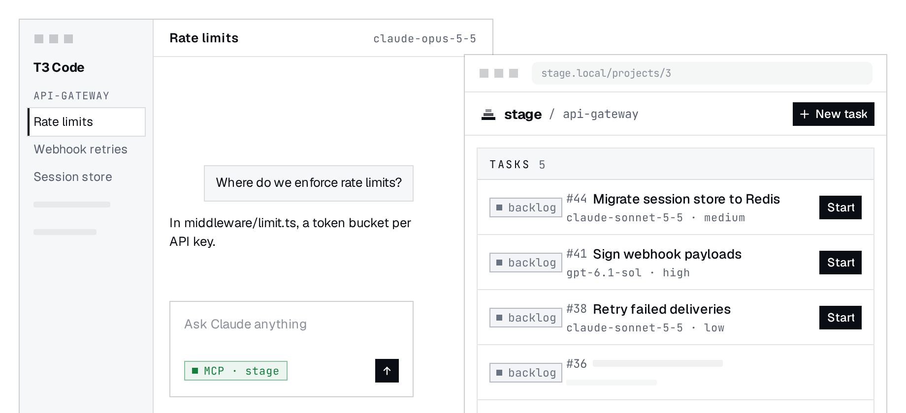

<p align="center">
  
</p>

<h1 align="center">stage</h1>

<p align="center">
  <b>Manage tasks across T3 Code and OpenCode.</b><br>
  Queue work in either harness, review final replies, and choose when to release the next task.
</p>

<p align="center">
  <a href="https://stage.hoplabs.dev">Website</a> ·
  <a href="https://stage.hoplabs.dev/docs">Docs</a> ·
  <a href="#install">Install</a>
</p>

<p align="center">
  <picture>
    <source media="(prefers-color-scheme: dark)" srcset="docs/assets/readme-cover-dark.webp">
    
  </picture>
</p>

Coding agents are fast. Keeping track of what they should do next is the slow part. stage is a self-hosted task manager for [T3 Code](https://github.com/pingdotgg/t3code) and OpenCode: write prompts ahead of time, link tasks that depend on each other, and let agents plan work into it themselves. You review each final reply in stage and decide when the next task starts.

It runs on your own machine as a desktop app or a headless server. Projects, journals and accepted results stay on your server, even when a harness is offline.

## Features

- **Write the prompt now. Start it later.** Save a task with its prompt, harness, model, effort and workspace (root or worktree). It waits in the backlog until you start it, or until something you queued starts it.
- **Tasks wait for what they need.** Put tasks in a tree, across projects if needed. A task becomes ready when you complete its needs in stage, and each one's final reply, links and branch are handed off into its prompt. Stacked work can start from a need's branch.
- **Plan in one session. Fan out across models.** Agents use stage's MCP server or CLI to create tasks, build trees and pick the model each piece needs. `--after-me` queues work to follow the current session.
- **Run it once at nine, or every weekday.** Start a backlog task at a set time, or make a schedule (presets or 5-field cron, per-schedule time zone) that spawns a fresh task on every fire.
- **Know when work needs you.** Install stage as a PWA and get a push when a task needs input, fails, is ready or is done. The app badge counts what is waiting.
- **One place for the whole picture.** The Dashboard puts needs input first, then trees, running, finished, ready and backlog work across projects. Append-only journals keep each task's and tree's findings and decisions.
- **Small things that add up.** Ctrl K palette, `/` snippets, pinned model defaults, prompt screenshots, and copyable task references that agents resolve with `read_ref`.

Full behavior: [docs/features.md](docs/features.md).

## Install

Linux and macOS, per user, no root. The desktop app includes the CLI/server; `--headless` installs the CLI/server only, for remote machines (and Macs until the Mac desktop ships).

```sh
curl -fsSL https://raw.githubusercontent.com/flexdinesh/stage/main/scripts/install.sh | sh                  # desktop
curl -fsSL https://raw.githubusercontent.com/flexdinesh/stage/main/scripts/install.sh | sh -s -- --headless  # CLI/server only
```

Then open Settings and connect an existing T3 service, an OpenCode 2.3.0 service, or both. `stage update` installs the latest release, `stage update --check` compares versions, and `stage uninstall` removes stage and keeps your data. Headless: `stage service start` runs the server as a per-user service. Guide: [Install](https://stage.hoplabs.dev/docs/install).

## For agents

Register stage with your agents once:

```sh
stage setup mcp            # stdio MCP for Claude Code and Codex (--http registers /mcp instead)
stage setup instructions   # usage block in ~/.claude/CLAUDE.md and ~/.codex/AGENTS.md
```

Then a session can queue and link work itself, over MCP (`create_task`, `create_tree`, `start_tree`, ...) or the CLI:

```sh
stage task add --title "Add sessions table" --prompt "..." --effort high   # backlog
stage tree new --title "Auth" 41 43:41 42:43                               # 43 needs 41, 42 needs 43
stage task add --title "Deploy" --prompt-file deploy.md --after-me         # after you complete this session's task
```

OpenCode setup and the full tool list: [Agents, CLI and MCP](https://stage.hoplabs.dev/docs/agents).

## HTTPS and push notifications

Push notifications and installing the PWA need a secure context. `http://localhost` is one, so both work in a browser on the stage machine with no setup. Other devices (phone, laptop) need HTTPS with a certificate they trust, for example:

```sh
tailscale serve --bg http://127.0.0.1:7380    # https://<machine>.<tailnet>.ts.net, tailnet only
```

or Caddy (`reverse_proxy 127.0.0.1:7380`) with a real or mkcert certificate. Add that HTTPS origin to `STAGE_PUBLIC_URL` or `STAGE_ALLOWED_ORIGINS`, or stage answers `403 host … not allowed`. Then open the URL, add it to the Home Screen (iOS 16.4+) or Dock (macOS Safari), and enable Settings, Notifications. Full setup, proxy streaming settings and the security model: [Headless server](https://stage.hoplabs.dev/docs/deploy#https-and-push-notifications).

## Docs

User guides: [stage.hoplabs.dev/docs](https://stage.hoplabs.dev/docs) (install, connect a harness, desktop app, headless server, features, agents).

Engineering contracts:

- [architecture.md](docs/architecture.md): ownership, UI hosts, platform contract, documentation ownership
- [api.md](docs/api.md): REST API, MCP and CLI contract
- [features.md](docs/features.md): detailed feature behavior
- [install.md](docs/install.md), [release.md](docs/release.md): installer, updates, release assets
- [runtime.md](docs/runtime.md), [service.md](docs/service.md): server runtime, listeners, origin policy, per-user service
- [desktop.md](docs/desktop.md): desktop app
- [development.md](docs/development.md): development tasks and Stage Dev installs

## License

[MIT](LICENSE)
